<div align="center">

<picture>
  <source media="(prefers-color-scheme: dark)" srcset="public/brand/logo-dark.svg">
  
</picture>

### A US marketplace for moving, vehicle, freight and heavy-equipment shipping, rebuilt from scratch as one Next.js app

Shippers post a load. FMCSA-verified carriers bid. The shipper's money waits in escrow until delivery is confirmed.<br>
Everything else (dispatch, drivers, live GPS, chat, disputes, payouts) and an AI assistant that works with real data.

<br>


<br>

<picture>
  <source media="(prefers-color-scheme: dark)" srcset=".github/readme/home-hero-dark.webp">
  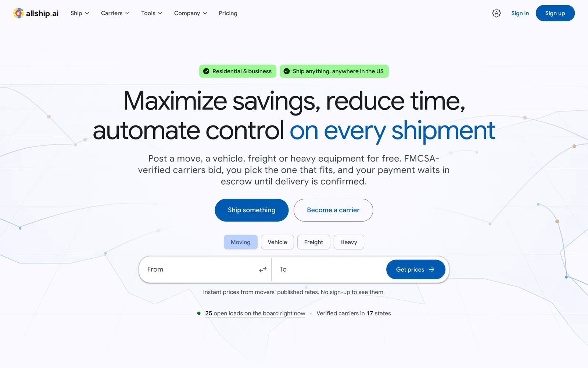
</picture>

</div>

---

## At a glance

| | |
|---|---|
| **Role** | Solo full-stack: product, architecture, design system, frontend, backend, payments, security, data migration |
| **Scope** | Marketing site (~30 pages + 23 service pages + Ads landing pages), dashboards for 4 roles, admin console, API, crons |
| **Size** | ~69k lines of TypeScript · 98 pages · 17 route handlers · 46 Postgres tables · 6 migrations |
| **Core** | Next.js 16 App Router (RSC, Server Actions) · Drizzle ORM · Better Auth · Stripe Connect · Supabase · OpenAI |
| **Quality** | Strict TypeScript, ESLint, 290 unit tests, DB-backed authorization tests, CI on every push |

## The story

AllShip AI started as three separate repos: an Express + MongoDB API, a React dashboard and a marketing site. It worked, but it was hard to change and hard to trust:

- **Security.** The sign-up endpoint had no bot protection and was used for email bombing. There was no CSP and no consistent authorization layer.
- **Data.** Most of the database was bots, test data and auto-generated AI bids. The "best match" carrier was hard-coded, and some ratings were random numbers.
- **Product.** There was no escrow, no proper load lifecycle and no driver flow. Every change had to be made in three codebases.

I rebuilt it as **one Next.js app** with a clean domain model, real escrow, role-based access and a Material 3 design system. I kept what had value: the URLs, the marketing structure and copy, the real users and carriers, and carriers' rate cards. The 16 real accounts and 5 carriers moved over with their bcrypt hashes and rate tiers. The bots and fake records were left behind.

## Product tour

### Marketing site that converts and shows the real product

The home page leads with text, so the hero headline is the LCP element and is fully server-rendered. Behind it, a **raw WebGL2 contour field** draws US freight lanes. It loads after idle, pauses offscreen, and falls back to a static poster on software renderers or with reduced motion. A quick-quote starter and live board counts (straight from the database) sit right under the call to action.

<table>
<tr>
<td width="50%">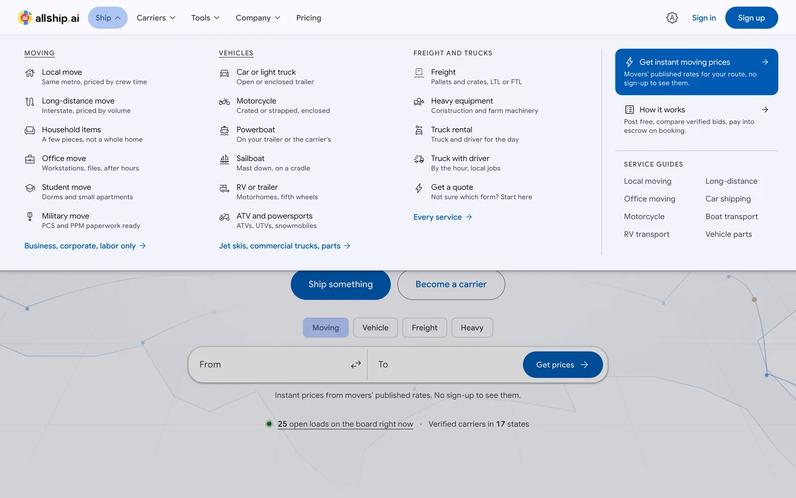<br><sub><b>Mega menu.</b> Each category and transport type deep-links into a public form with the type preselected. The panels load only on hover.</sub></td>
<td width="50%">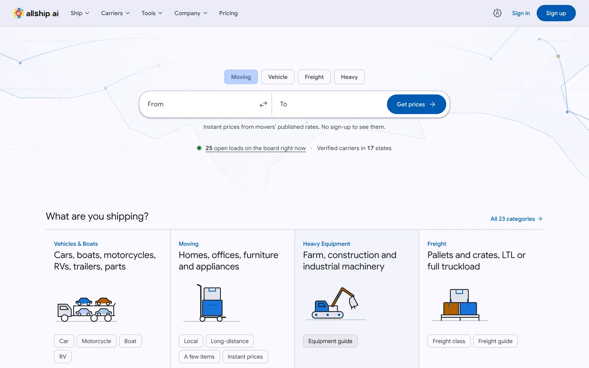<br><sub><b>23 load categories</b> with custom SVG illustrations that follow the light and dark tokens.</sub></td>
</tr>
</table>

### "Product Theater": a cursor that walks through the real UI

The marketing site doesn't use screenshots. A small engine (~10 KB gzipped) plays scripted demos built from the app's own components. A cursor moves along eased paths and clicks, types and highlights. The frame morphs from desktop to tablet to phone, and the bullet points stay in sync with the step that is playing. Each demo is server-rendered as a static first frame (no layout shift, readable without JS). The engine loads only near the viewport, pauses offscreen, and shows the end state under `prefers-reduced-motion`.

<table>
<tr>
<td width="50%">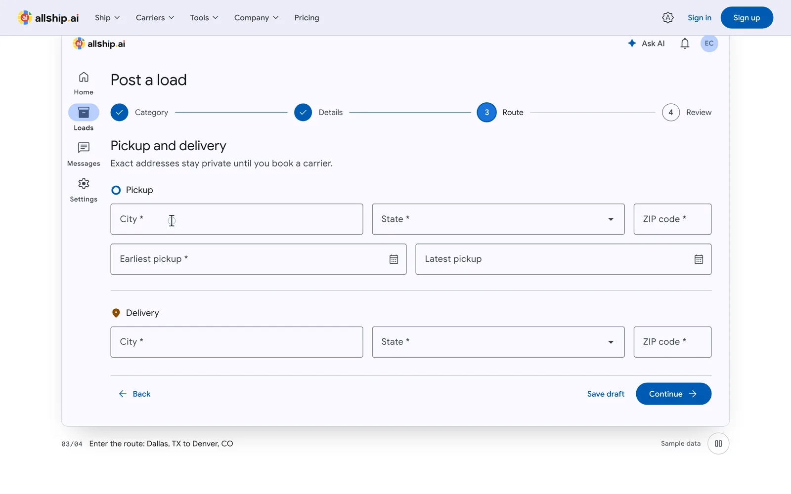<br><sub><b>Post a load.</b> The real wizard, typed into by the demo cursor.</sub></td>
<td width="50%">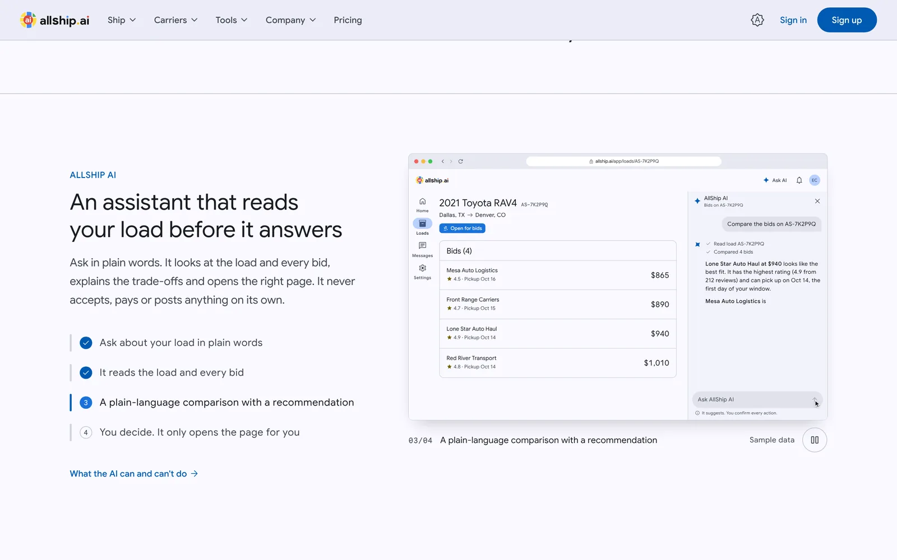<br><sub><b>AI assistant demo</b>, with its feature list synced to the step that is playing.</sub></td>
</tr>
<tr>
<td width="50%">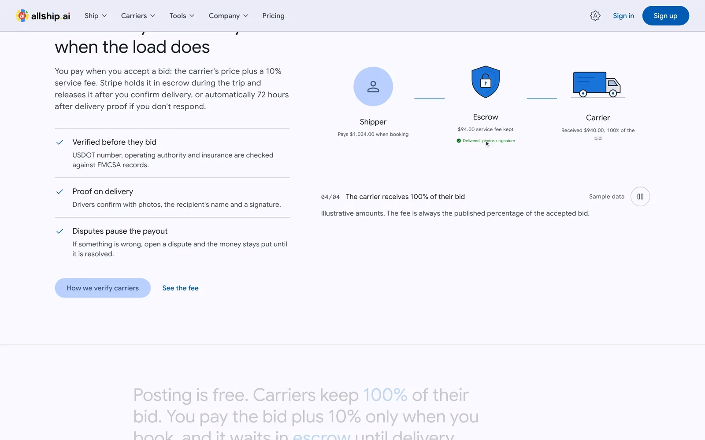<br><sub><b>Escrow flow:</b> shipper → escrow → carrier after proof of delivery.</sub></td>
<td width="50%">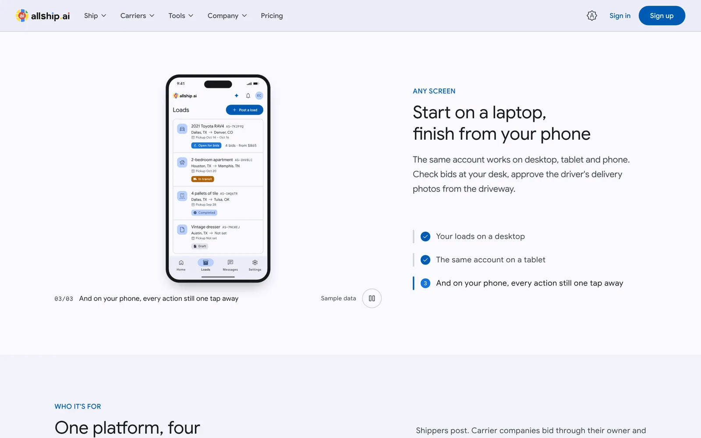<br><sub><b>Adaptive demo:</b> the same screen morphs from desktop to phone.</sub></td>
</tr>
</table>

There are 15 scenes: post a load, compare bids, AI assistant, AI-drafted load and bid, carrier board, instant quote, live tracking, driver trip, fleet, chat, rate card, escrow, adaptive and guided tour.

### Shipper: post, compare, pay into escrow, track

<table>
<tr>
<td width="50%">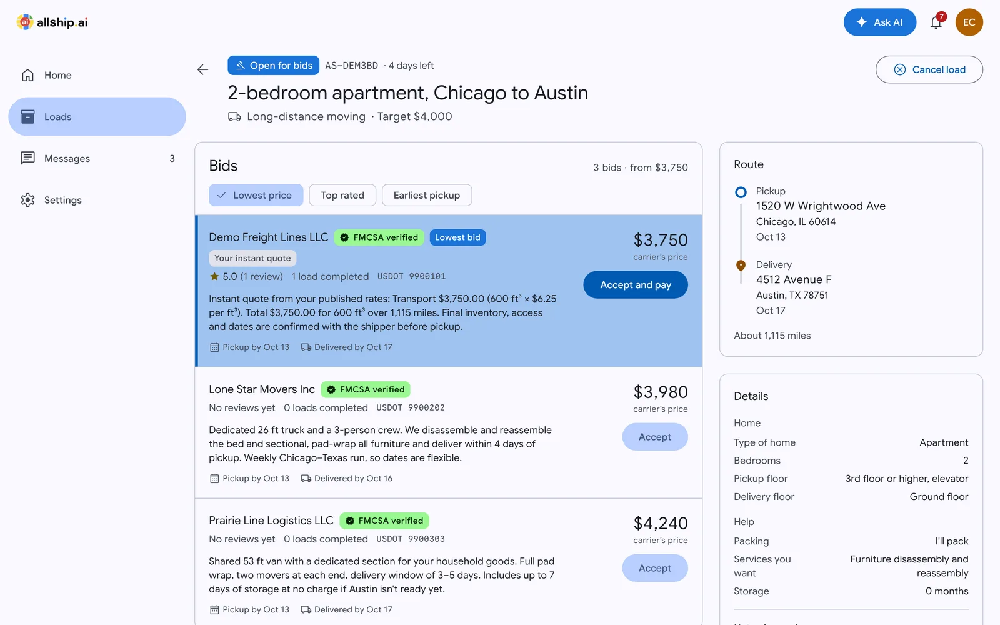<br><sub><b>Bid comparison.</b> FMCSA status, rating, completed loads, dates and message for each bid. Instant quotes computed from the carrier's published rate card are highlighted.</sub></td>
<td width="50%">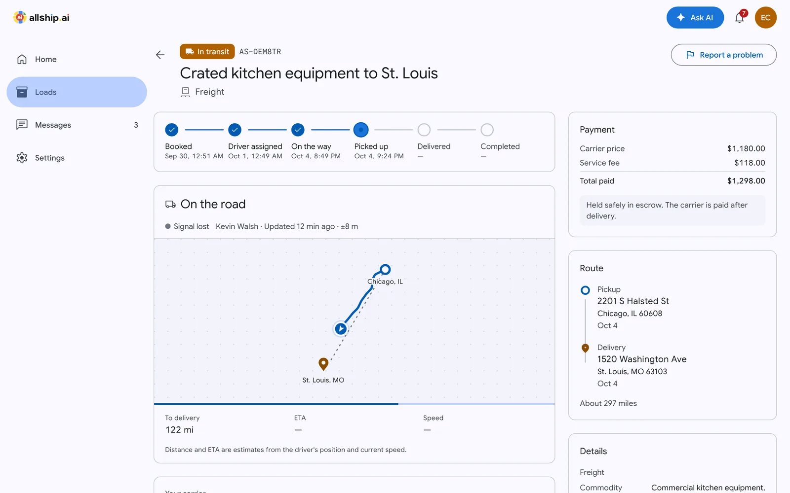<br><sub><b>Live trip</b> with a status stepper, GPS trail, ETA and signal-lost detection. The <b>AI assistant</b> panel (Ctrl/⌘ J) answers from the user's real loads and bids.</sub></td>
</tr>
</table>

### Carrier: find loads, bid, dispatch, watch the fleet

<table>
<tr>
<td width="50%">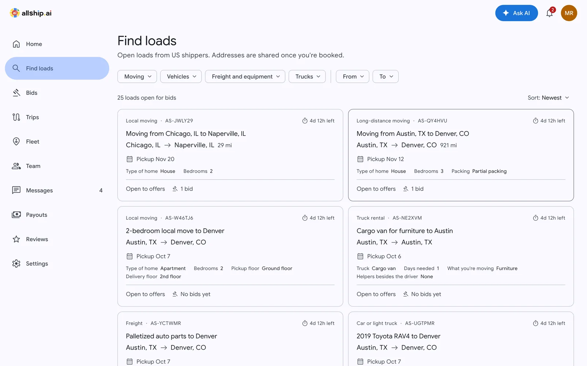<br><sub><b>Load board</b> with filters kept in the URL. Bids show a live "you receive / shipper pays" breakdown. Carriers keep 100% of their bid.</sub></td>
<td width="50%">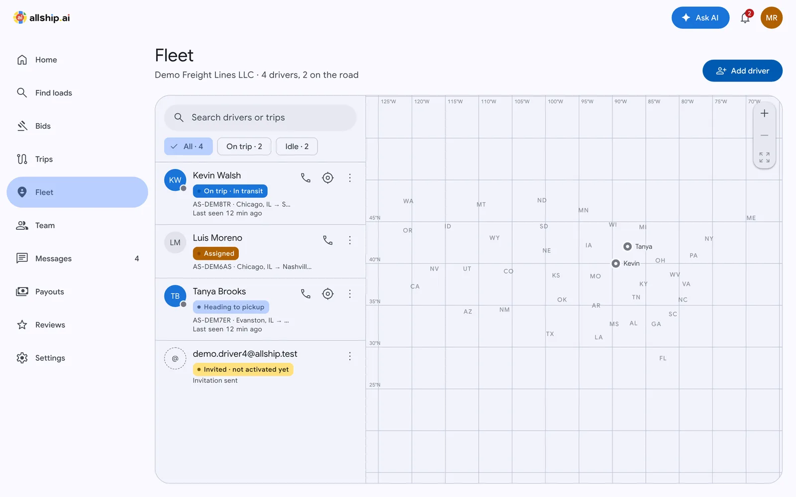<br><sub><b>Fleet.</b> Add drivers (the account is created and a sign-in link is sent), see their status, and follow live positions on the map. Stale positions are greyed out after 5 minutes.</sub></td>
</tr>
</table>

### Driver: a mobile-first trip screen

<table>
<tr>
<td width="34%">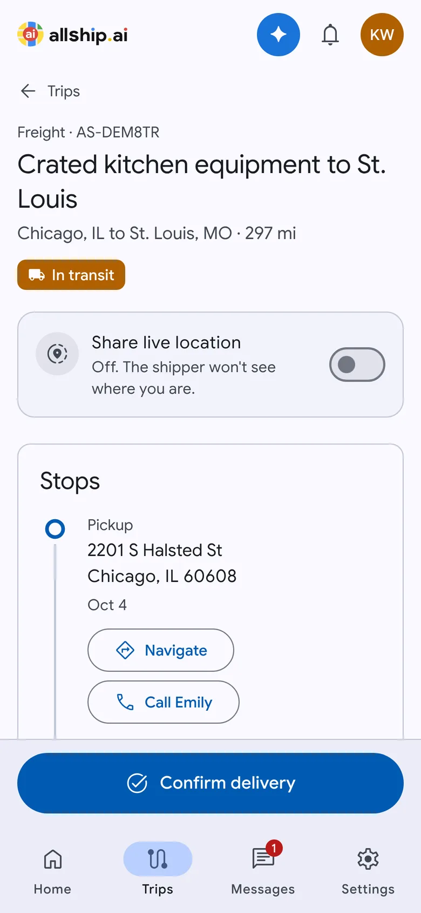</td>
<td>

The driver's whole job fits on one screen, with the next action in a sticky bottom bar:

1. **Start trip**, then opt in to **live location sharing**. It uses `watchPosition`, keeps the screen awake with the Wake Lock API, sends at most one point every 20 s, and handles a denied permission clearly.
2. **Confirm pickup** with photos. Images are shrunk in the browser to about 2000 px before upload, which saves mobile data.
3. **Confirm delivery** with POD photos, the recipient's name and a signature drawn on a canvas.
4. **Navigate** and **Call** buttons open the native apps.

The shipper sees every step live. The payout is released when they confirm delivery, or automatically after 72 h.

</td>
</tr>
</table>

### Admin console

The admin console covers the carrier verification queue (FMCSA), loads, payments and payouts (with transfer retry), disputes (release, refund or split), leads with UTM/gclid, users, a blog editor with AI writing helpers and scheduling, curated testimonials, and the email sequences funnel. **Every admin action requires 2FA.**

## Architecture

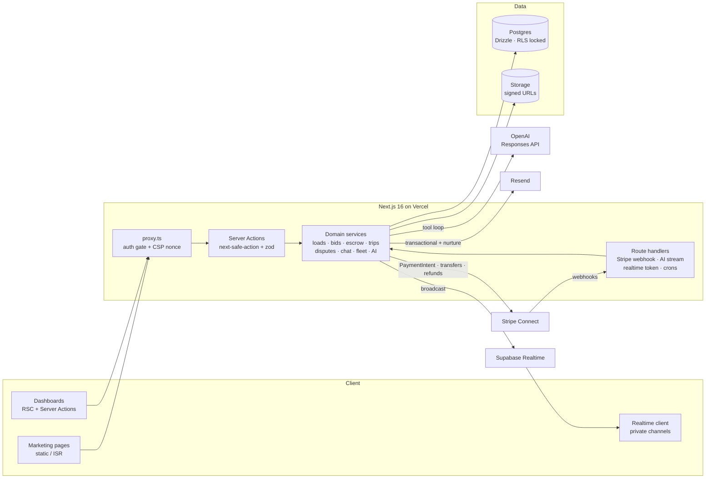

### Load lifecycle

Every status change goes through one function, `transitionLoad`. It checks an explicit transition table (which actor may move which status), uses an optimistic status check against races, and writes a timeline event.

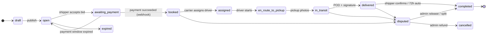

### Money flow

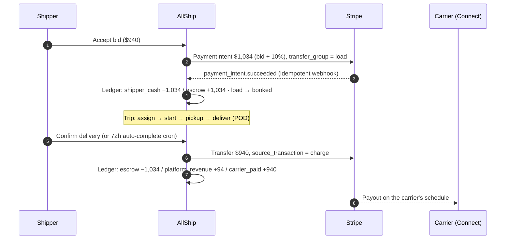

## Engineering highlights

<details open>
<summary><b>Escrow with a double-entry ledger</b></summary>

- Separate charges and transfers on Stripe Connect Express. The PaymentIntent uses `transfer_group = load.id` and the payout transfer uses `source_transaction`, so funds are never transferred before they settle.
- Every money movement writes a balanced journal (`ledger_entry`): payment, release, platform fee, refund, partial (split) refund, and cancel-with-compensation. Each journal is verified to sum to zero.
- The webhook is idempotent: a `stripe_event` table records processed events (the row is removed if the handler fails, so Stripe retries). It also enforces a 1 MB body cap and a 300 s replay window, and supports two signing secrets (platform and Connect).
- Without Stripe keys, a **simulated payment mode** (refused in production) runs the full flow locally.

</details>

<details>
<summary><b>Authorization: audited 109 entry points</b></summary>

- Every server action goes through `authedAction` and resolves a fresh `Actor` from the database. That includes the role in the carrier org, banned state, and admin status, which counts only with 2FA on. Admin pages and actions require 2FA.
- Load access is checked in one function, `loadWithRole()`, which returns shipper, carrier, driver, admin or nothing. A driver counts only while they are still on the carrier's team.
- An OWASP API Top 10 pass covered all server actions, route handlers and pages that load data by ID. It found and fixed:
  - Better Auth org and admin endpoints that could be called directly over HTTP, bypassing the app's team rules. They are now blocked over HTTP and allowed only from the server.
  - A self-service `accountType` switch: a carrier could become a shipper and bid on their own loads.
  - Competitor bid amounts leaking into a trip timeline.
  - Accept-vs-withdraw and double-pay races. These now use locks in a consistent order and re-check the state inside the transaction.
- **DB-backed integration tests** cover the worst cases: cross-org access, driver location on a trip they're not assigned to, a non-admin resolving a dispute, competitor bid leaks, and access by removed team members.

</details>

<details>
<summary><b>Realtime without exposing the database</b></summary>

- RLS is enabled on every table and the `anon` and `authenticated` roles have no grants. The browser never queries tables.
- Live updates use **Supabase private broadcast channels**. The server signs a short-lived HS256 JWT whose `topics` claim lists exactly the channels this user may join: their own `user:`, plus the `load:` and `conv:` channels they take part in. A Postgres RLS policy on `realtime.messages` enforces that claim.
- With no Supabase keys, the same hook (`useRealtime`) falls back to polling, so everything works locally.

</details>

<details>
<summary><b>AI assistant with tools, scoped by role</b></summary>

- Uses the OpenAI **Responses API** with streaming and a tool loop of up to 5 rounds, streamed to the client as NDJSON. Answers render through a safe Markdown-to-React renderer, with no `innerHTML`.
- Tools are read-only and filtered by role. For example, `get_my_load` and `compare bids` exist only for shippers, `search_open_loads` only for carriers, `list_trips` for drivers.
- Write actions come back as **buttons the user confirms**: "Review and post this load" opens a prefilled wizard, "Review bid" a prefilled bid form, plus "Start tour" and "Open page". The assistant never changes anything itself.
- The system prompt treats tool results and user-written load notes as data, not instructions (prompt-injection hardening). Phone numbers and emails are stripped from AI-drafted bids.
- Rate limits are 20 messages per 5 minutes and 200 per day. Without an API key, a **deterministic offline mode** runs the same tools, which keeps demos and E2E tests realistic.
- **10 Driver.js guided tours**, one welcome tour per role. The assistant can start them, and a tour can move to another page before it begins.

</details>

<details>
<summary><b>Honest instant quotes and a lead-to-client funnel</b></summary>

- The old matcher forced one "Best Match" carrier and showed random ratings. The new one prices each carrier from their **published rate card**: mileage tiers × volume + packing, unpacking and storage. A carrier with no tier for the distance is left out, not guessed. Ratings come only from real reviews, and the "Lowest price" and "Top rated" labels appear only when true.
- **Public load forms** don't ask for sign-up up front:
  - The email is captured when its field is completed, which starts the abandoned-form sequence.
  - Submitting creates a passwordless account and a draft load.
  - A 72-hour "confirm to publish" magic link signs the user in and publishes the load.
- **Nurture email sequences** (verify-to-publish, abandoned form, load follow-up, post-delivery review, carrier activation):
  - Each step re-checks its condition when it sends.
  - Recipients are processed with `FOR UPDATE SKIP LOCKED`, so concurrent cron runs never double-send.
  - Quiet hours follow the recipient's time zone, with a daily cap per recipient.
  - CAN-SPAM: one-click `List-Unsubscribe`, a suppression list, and transactional mail kept separate from marketing mail.

</details>

<details>
<summary><b>Security hardening</b></summary>

- **Two CSP modes:**
  - Dynamic surfaces (`/app`, `/admin`, auth) get a per-request nonce with `'strict-dynamic'`.
  - Marketing pages stay static/ISR with a hash-based policy that lists the exact third-party hosts.
  - Violations are reported to a rate-limited endpoint.
- **Uploads:** files go straight from the browser to storage through signed URLs. The type is checked from the file's bytes (magic bytes), the request body is size-capped as it streams, storage keys are validated against `../` path tricks, and SVG and HTML are rejected.
- **Auth:** Better Auth with email + password (plus a breached-password check that never blocks sign-in if the check service is down), Google, magic link, email OTP, **TOTP 2FA and passkeys**. Turnstile protects sign-up and password reset, rate limits are stored in the database, and legacy bcrypt hashes are rehashed on first login.
- **Other:** open-redirect-safe `next` parameters, timing-safe cron secrets, `X-Robots-Tag` on private routes and preview deployments, and `pnpm audit` clean of high and critical issues.
- **Privacy (CCPA-ready):** users can download their data and delete their account. Deletion anonymizes the profile but keeps financial records.

</details>

<details>
<summary><b>Design system and performance</b></summary>

- **Material 3 tokens** are generated from the logo blue with `material-color-utilities` (light and dark). The type scale uses Google Sans, which is self-hosted. Icons are Material Symbols, compiled into tree-shaken path exports. All components are custom M3 components on Radix primitives.
- **Motion:** GSAP for M3-eased transitions, Lenis smooth scroll, scroll-scrubbed parallax and word reveals, and a sliding nav indicator. Everything respects `prefers-reduced-motion`, and content is never hidden from crawlers or no-JS visitors.
- **Code kept out of bundles:** the WebGL, the Theater engine, GSAP, the mega-menu panels and Sentry all load lazily. Client code never imports the env module, so zod stays out of the browser bundle.
- **SEO:** unique metadata per page, JSON-LD (Organization, Service, FAQPage, BreadcrumbList, Article), segmented sitemaps, 301s that preserve the old URLs, and Consent Mode v2 + GTM with UTM/gclid attribution for Google Ads.

</details>

## Tech stack

| Area | Tools |
|---|---|
| Framework | Next.js 16 (App Router, RSC, Server Actions, `proxy.ts`), React 19, TypeScript 6 strict |
| UI | Tailwind CSS v4, Material 3 tokens, Radix primitives, Google Sans, Material Symbols, GSAP, Lenis, raw WebGL2, Driver.js |
| Data | Postgres (Supabase), Drizzle ORM, RLS lockdown, Supabase Realtime and Storage |
| Auth | Better Auth: email/password, Google, magic link, OTP, TOTP, passkeys, organizations, admin |
| Payments | Stripe Connect Express: escrow via separate charges and transfers, refunds, disputes |
| AI | OpenAI Responses API with function tools, streaming NDJSON, offline mode |
| Email | Resend, React Email, nurture sequences, unsubscribe and suppression |
| Ops | Vercel (crons), Sentry (PII-scrubbed), structured JSON logs, `/api/health`, GitHub Actions CI |
| Testing | Vitest (unit + DB integration), Playwright for E2E and visual checks, Lighthouse |

## Project structure

```text
src/
├─ app/
│  ├─ (marketing)/    public site: static/ISR pages, blog, tools, service pages
│  ├─ (landing)/      Google Ads landing pages and /quote
│  ├─ (auth)/         sign-in, sign-up, 2FA, invites (nonce CSP)
│  ├─ (app)/app/      dashboards: loads, board, bids, trips, fleet, team, messages, payouts…
│  ├─ (admin)/admin/  admin console
│  └─ api/            Stripe webhook, AI stream, realtime token, crons, uploads, health
├─ server/            domain services: loads, bids, payments, trips, disputes, chat, fleet,
│                     ai, nurture, funnel, matcher, auth, db/schema
├─ features/          UI feature modules per domain
├─ components/        ui (M3 primitives), sections, theater, webgl, motion, marketing
└─ lib/               seo, security, realtime, money, analytics, logging
drizzle/              SQL migrations (incl. RLS and realtime policies)
scripts/              legacy import, demo seed, tokens, icons
tests/                unit + integration (authorization)
```

## Run it locally

```bash
pnpm install
cp .env.example .env.local          # DATABASE_URL, BETTER_AUTH_SECRET, BETTER_AUTH_URL, NEXT_PUBLIC_APP_URL
pnpm db:migrate
pnpm demo:seed --yes                # demo accounts for every role, password AllshipDemo2026!
pnpm dev
```

It runs without any third-party keys: payments are simulated, emails print to the terminal, uploads go to `.uploads/`, realtime falls back to polling, and the AI runs in offline mode. Production setup (Stripe webhooks, Supabase buckets and Realtime, crons, Sentry, CSP) is in **[DEVELOPMENT.md](DEVELOPMENT.md)**.

| Try it as | Email |
|---|---|
| Shipper with 14 loads in every state | `demo.shipper@allship.test` |
| Carrier owner with dispatcher and 3 drivers | `demo.carrier@allship.test` |
| Driver on a live trip | `demo.driver3@allship.test` |
| Admin (2FA, secret printed by the seed) | `demo.admin@allship.test` |

## What I'd do next

- A mobile performance pass on the marketing pages. The Theater posters and the shared icon chunk are the biggest costs left.
- Real-key end-to-end runs against Stripe test mode, Supabase Realtime and Google Maps.
- i18n on top of the existing `user.locale`.
- Proper columns for driver documents (CDL, insurance) instead of audit-log notes.

---

<div align="center">

Built by **Yaroslav Tsarenko**, full-stack developer (Node.js · React · Next.js · TypeScript · Postgres · payments)

</div>
